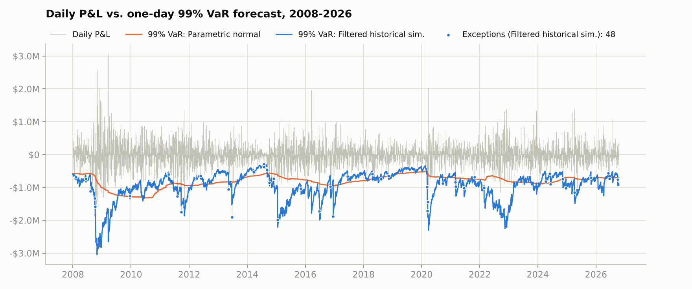
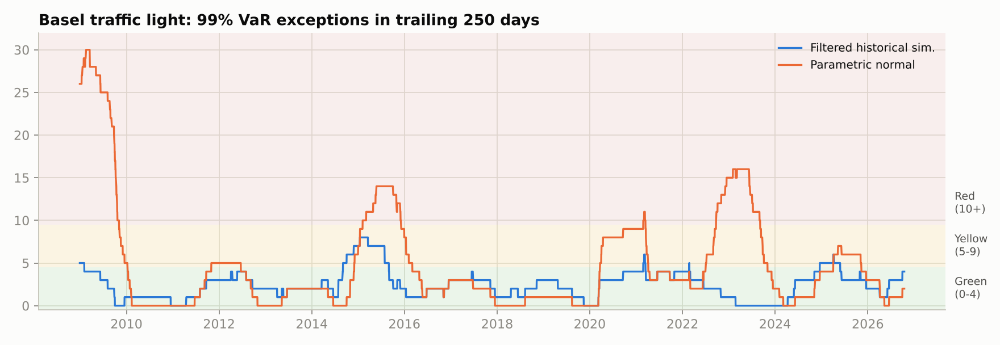
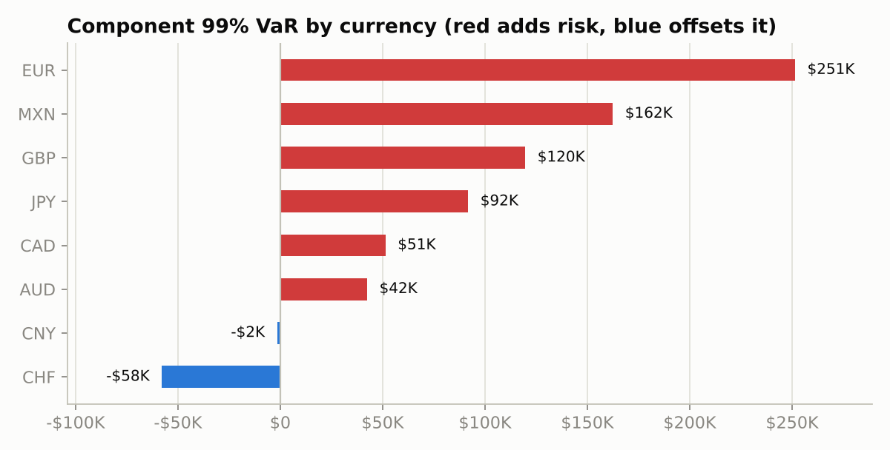
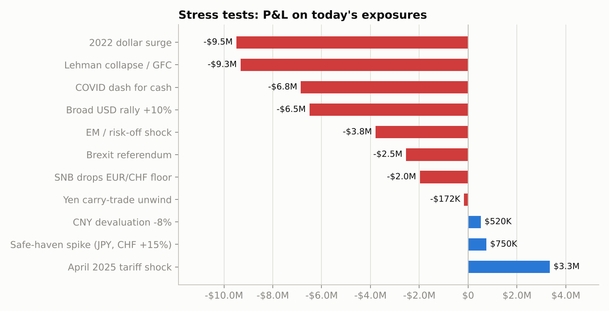

# FX Risk Engine

Measures the foreign-exchange market risk of a multi-currency portfolio. The engine forecasts one-day **Value-at-Risk (VaR)** and **Expected Shortfall (ES)** with five models, backtests every model out of sample over 18 years of daily data, stress-tests the book against historical crises, and breaks total risk down by currency.

**Portfolio:** a hypothetical US company's net FX exposure, $115M gross across 8 currencies:

| EUR | JPY | GBP | CAD | AUD | MXN | CHF | CNY |
|---|---|---|---|---|---|---|---|
| +$30M | +$15M | +$15M | +$10M | +$8M | +$12M | −$10M | −$15M |

Long positions are foreign revenue and receivables; the short CHF position is a franc-denominated loan and the short CNY position is supplier payables.

**Data:** Federal Reserve H.10 daily exchange rates (published on FRED), Jan 2003 to Oct 2026, 5,964 trading days.

## Key results

Out-of-sample backtest of 99% one-day VaR, Jan 2008 to Oct 2026 (4,704 days, 47 exceptions expected):

| Model | Exceptions | Kupiec p | Cond. coverage p | ES test Z2 | Days in Basel red zone |
|---|---:|---:|---:|---:|---:|
| Historical simulation | 52 | 0.475 | <0.001 | −0.22 | 4.2% |
| Parametric normal | 95 | <0.001 | <0.001 | −1.51 | 15.1% |
| EWMA (RiskMetrics) | 91 | <0.001 | <0.001 | −1.22 | 3.7% |
| **Filtered historical simulation** | **48** | **0.888** | **0.803** | **−0.06** | **0.0%** |
| GARCH(1,1)-t | 62 | 0.037 | 0.004 | −0.54 | 1.2% |

- **Normal-distribution VaR fails.** It had 2× the promised number of breaches and spent 15% of the period in the Basel red zone. Portfolio P&L has excess kurtosis of 4.7, so extreme days are far more common than a bell curve predicts.
- **Filtered historical simulation (FHS) is the only model that passes every test.** It handles both fat tails (by reusing real historical shocks) and volatility clustering (by rescaling them to current EWMA volatility). It had half as many exceptions as the normal model and never entered the red zone.
- **Risk is concentrated in EUR.** The euro position contributes 38% of portfolio VaR; the CHF loan offsets 9% because the franc tends to move with the euro. Diversification lowers VaR by 37% compared with summing standalone VaRs.
- **Stress losses dwarf one-day VaR.** Replaying the 2022 dollar surge on today's book loses $9.5M, and the Lehman/GFC window loses $9.3M, roughly 10× the one-day 99% VaR.




<p float="left">
  
  
</p>

An interactive version (model selector, crisis zoom, hover tooltips, correlation matrix) is in `dashboard/index.html`. Open it in any browser.

## Methodology

**VaR / ES models** (`src/fxrisk/models.py`). Every forecast for day *t* uses only data through day *t−1*.

| Model | How it works |
|---|---|
| Historical simulation | Empirical quantile of the last 500 days of P&L |
| Parametric normal | Normal distribution, volatility from a 500-day equally weighted window |
| EWMA (RiskMetrics) | Normal distribution, exponentially weighted volatility (λ = 0.94) |
| Filtered historical simulation | Past P&L divided by its EWMA volatility, then rescaled by today's volatility forecast |
| GARCH(1,1)-t | GARCH volatility with Student-t errors, re-estimated every 20 days on a rolling 1,000-day window |

**Backtesting** (`src/fxrisk/backtest.py`)
- Kupiec proportion-of-failures test: is the exception rate right?
- Christoffersen independence test: do exceptions cluster in time?
- Conditional coverage: both of the above jointly.
- Acerbi–Székely Z2 test for Expected Shortfall.
- Quantile (pinball) loss for ranking models.
- Basel traffic light on rolling 250-day windows.

**Risk attribution** (`src/fxrisk/attribution.py`). Euler decomposition of VaR under an EWMA covariance matrix: marginal VaR, component VaR (sums exactly to portfolio VaR), standalone VaR and diversification benefit.

**Stress testing** (`src/fxrisk/stress.py`). Seven historical windows (Lehman 2008, SNB floor removal 2015, Brexit 2016, COVID 2020, 2022 dollar surge, 2024 yen carry unwind, April 2025 tariff shock) replayed on current exposures, plus four hypothetical shocks and the worst 10-day loss in the data.

## Run it

```bash
pip install -r requirements.txt
python run_analysis.py            # uses data/raw/fx_daily.csv
python run_analysis.py --refresh  # downloads the latest rates first
python dashboard/build_dashboard.py
pytest -q
```

`run_analysis.py` prints a summary and writes backtest tables, stress results, component VaR and GARCH parameter history to `outputs/`, figures to `outputs/figures/`, and the dashboard data to `dashboard/results.json`. A full run takes about 10 seconds.

Change the portfolio in `src/fxrisk/portfolio.py`.

## Project structure

```
fx-risk-engine/
├── run_analysis.py          # end-to-end pipeline
├── src/fxrisk/
│   ├── data.py              # load + clean H.10 rates, compute returns
│   ├── portfolio.py         # exposures and P&L
│   ├── models.py            # 5 VaR/ES models
│   ├── backtest.py          # Kupiec, Christoffersen, Z2, Basel zones
│   ├── stress.py            # historical + hypothetical scenarios
│   ├── attribution.py       # EWMA covariance, component VaR
│   └── figures.py           # static charts
├── tests/test_fxrisk.py     # closed-form checks, no-look-ahead check, test power checks
├── dashboard/               # interactive HTML report
├── data/raw/fx_daily.csv
└── outputs/
```

## Tests

The test suite checks the normal and Student-t VaR/ES formulas against closed-form values and Monte Carlo, confirms that changing today's P&L never changes today's forecast (no look-ahead bias), verifies that the backtests accept a correct model and reject a broken or clustered one, and checks that component VaRs sum to portfolio VaR.

## Limitations and extensions

- One-day horizon only. A 10-day regulatory VaR could be added with filtered bootstrap paths rather than the square-root-of-time rule.
- The data are noon New York fixes, so intraday moves that reverse before noon are missed. During local holidays (e.g. China's Golden Week) some fixes are flat.
- Exposures are held constant. A next step is to model a company's actual cash-flow calendar and test a hedging program (forwards on the largest exposures) against the same risk metrics.
- Multivariate models (DCC-GARCH, t-copula Monte Carlo) would let correlations change during stress.
